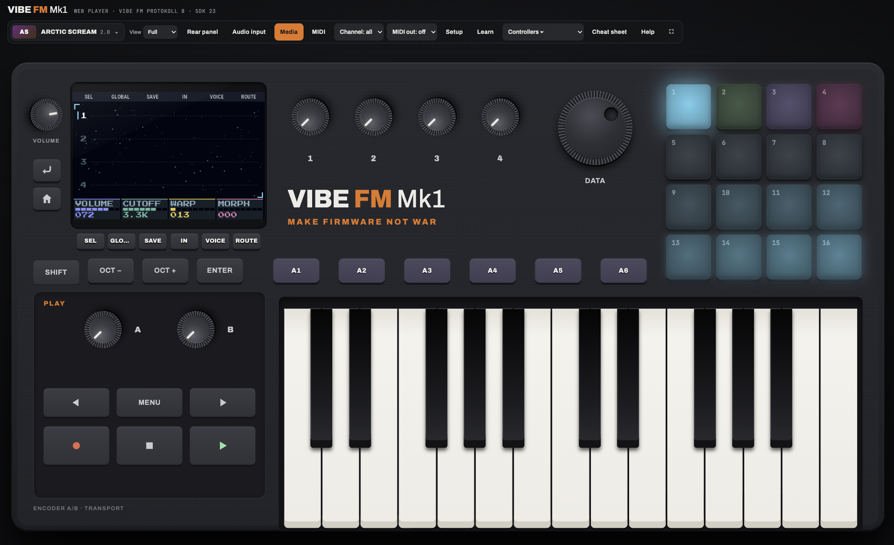

# Arctic Scream VIBE

**Long dark screaming ambient from the frozen Arctic, as a native firmware for VIBE FM:** a plugin in your DAW
(VST3 / AU / CLAP through VIBE FM VST), a page in your browser (the Playground) and an instrument on the VIBE FM
hardware. Built with the VIBE FM SDK.



It is [Arctic Scream](https://github.com/PolarPatch/Arctic-scream-FM-1) for the M-VAVE FM-1, the same engine and the
same version (2.0), with what the FM-1 cannot do:

- **Sound in.** IN 1 / IN 2 (a microphone, a line, a guitar) through the **VOICE**, a horror voice (PITCH down,
  RING, GROWL), into **Holvut's strings**: the feedback loop hears your voice and grows its howl out of it. Into the mix
  and SPACE, DELAY and GRAIN too.
- **Long samples.** Four slots of ~95 seconds each (the FM-1 has 6.6 s): **record** the input into a slot, or **load a
  WAV** from the VIBE's card, a USB stick or the plugin's folder (any rate, 8 to 32 bit or float, mono or stereo), or
  drop one onto the plugin's window.
- **Six demos on K1 .. K6**: A1 MANDALORIA, A2 WHITEOUT, A3 NIGHT TERROR, A4 AURORA, A5 III and A6 BIEGGA, named on
  the display while they play.
- **The 16 pads**: the tracks, the projects A .. D, DICE's eight moods, and under a held button the FM-1's key layers
  (mutes and solos, the slots, the sequencer's tools, the performance tricks, GENERATE, ACCIDENT).
- **The big display**: HOME's four tracks and their waves over the night sky, out to the edges, in Arctic Scream's own
  pixel look.
- **The DAW**: the input's and the VOICE's settings are automatable parameters; the projects, settings and samples are
  saved in the DAW's project.

Coming with 2.2 (on the branch `feature/2.2`, not released yet): the pictures move (the aurora breathes, snow drifts,
water glitters), **JAHKI** (press LFO five times: the Arctic's year turning under the music through the eight Sami
seasons), the ice holding its breath, JIEHKKI's dusk and START ALWAYS.

Everything else is Arctic Scream 2.0: nine sound sources (Holvut, Biegga and the rest), 38 factory sounds, JIEHKKI (a
piece that plays itself), RUOHČAT, ŠUOKŊA's pure tunings, DICE, ACCIDENT, GENERATE, the sequencer and the effects. Its
manual: <https://github.com/PolarPatch/Arctic-scream-FM-1/blob/main/MANUAL.md>.

## Play it

- **In the browser:** open the Playground, <https://play.thefirmwarehub.com/>, and drop `arctic-scream-vibe.wasm` from
  the [releases](../../releases) onto the device.
- **In your DAW:** drop `arctic-scream-vibe.zip` onto the VIBE FM VST window (<https://thefirmwarehub.com/convert/#plugdl>).
- **On the VIBE FM:** from The Firmware Hub.

## The controls

| | |
| --- | --- |
| **K1 .. K6** | the demos A1 .. A6 |
| **F1 .. F6** | the pages: SOUND, ENV, LFO, ARP, FX, SEQ (again: the next page; held: its layer on the pads) |
| **SHIFT + F1 .. F6** | SEL, GLOBAL, SAVE; IN (again: SAMPLE), VOICE, ROUTE: sound in, the display split with the tracks |
| **Encoders 1 .. 4** | the four knobs on the display |
| **A** | the track into SPACE (SHIFT: DELAY) |
| **B** | SELECT: the tempo, the sequencer's steps |
| **DATA** | PRESETS: the sounds |
| **Keys** | the selected track (REC: into its sequence) |
| **Pads 1 .. 4** | the track; the selected one again: its LATCH on or off |
| **Pads 5 .. 8** | the projects A .. D (SHIFT + F3 SAVE held: saved there) |
| **Pads 9 .. 16** | DICE: a new part on the track, HUSH, STILL, SWELL, DRIFT, ECHO, PULSE, ARP, MACHINE (PLAY runs it) |
| **PLAY / REC** | the sequencer; REC records it (on SAMPLE: the input into the slot) |
| **STOP** | the sequencer, if it plays; else the track's sound let go (SHIFT: all four) |
| **◀ ▶** | UNDO, REDO |
| **RETURN** | back to HOME |
| **HOME / MENU** | what every control does |

## Build it

You need Zig 0.13.0, Node.js and a shell.

```sh
tools/get_sdk.sh          # the VIBE FM SDK, at the commit this is built with, into sdk/
tools/build.sh            # -> sdk/build/arctic-scream-vibe.{wasm,zip}, then vibe-check
python3 sdk/tools/emulator.py   # play it at http://127.0.0.1:8766
```

The engine in `firmware/arctic-scream-vibe/engine/` is Arctic Scream's, copied unchanged from its repository by
`tools/sync_engine.sh`: fixes go there first. `DEVELOPER.md` has the rest.

## Licence

GPL-3.0-only (`LICENSE`). Who made what, and the licences of the parts (the engine's, the SDK's Apache-2.0 and its
fonts' OFL), are in `LICENSING.md`. "VIBE FM" is a trademark of Sven Trogus; this firmware is built with the VIBE FM SDK.
